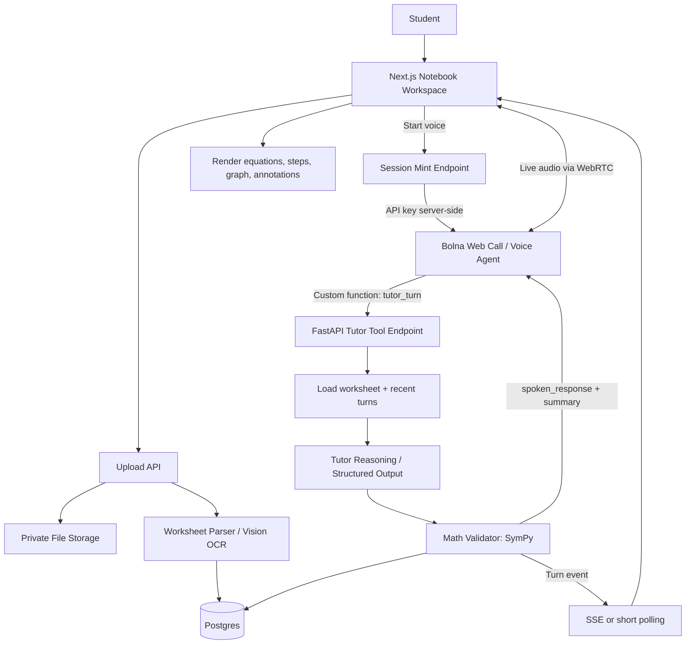

# Scribble — Product Requirements & Technical Specification

**Document type:** PRD + Technical Design  
**Version:** 1.0  
**Prepared:** 18 October 2026  
**Target event:** Bolna AI × Y Combinator Symphony Buildathon  
**Submission deadline listed on the buildathon page:** 31 October 2026  
**Project name:** Scribble  
**Working tagline:** *Your voice-powered AI math tutor, right inside your notebook.*

> **Scope decision:** Build a polished, end-to-end web demo where a student uploads a worksheet, asks a math question aloud through Bolna, and sees the tutor's grounded explanation and visual artifacts appear beside the work. Do not make the MVP depend on true ambient always-on listening, perfect handwriting imitation, or general-purpose OCR across every subject.

---

## 1. Executive Summary

Scribble is a voice-first AI math tutor designed to live beside a student's handwritten work. It removes the repeated context-switching loop of photographing a notebook, transferring the image to a phone, uploading it to an AI chatbot, explaining the context, and repeating the process for every doubt.

The student uploads a photo or PDF of their homework, reviews the extracted problem, and starts a voice session. They can then ask natural questions such as, “Why did you use the right-sided signal here?”, “Where did I make a mistake?”, or “Can you explain that step more slowly?” Scribble keeps the active worksheet as context, responds through a live voice agent powered by **Bolna**, and displays the explanation as readable steps, equations, error annotations, or a graph on a notebook-style canvas.

The product should feel like a tutor sitting next to the student—not like a chatbot that expects the student to keep packaging and uploading context.

### The core loop

1. **Drop in the homework** — upload a page image or PDF.
2. **Confirm the problem** — Scribble extracts the relevant math and lets the student correct mistakes.
3. **Ask out loud** — start a voice session and ask a question naturally.
4. **Understand** — Bolna manages the spoken conversation and calls Scribble's tutoring API for grounded help.
5. **See it on the page** — the answer appears as structured steps, equations, an error marker, or a graph.
6. **Continue without re-uploading** — follow-up questions reuse the active worksheet and conversation context.

### What makes it distinct

- **Voice is the primary input**, not a voice-to-text field added to a standard chatbot.
- The tutor understands the **current worksheet and current step**, rather than treating every question as an isolated prompt.
- Spoken explanations are connected to **visible, inspectable output**: equations, steps, mistakes, and plots.
- The tutor is designed to guide learning with hints and explanations instead of reflexively dumping a final answer.

---

## 2. Buildathon Fit and Constraints

The official buildathon page says participants may bring any idea as long as voice is part of it, describes the event as virtual before the finale, and lists the project submission deadline as **31 October 2026**. The grand finale is listed for **20 November 2026** at Symphony in Bengaluru. Check the official page for any updates before submitting.

- Buildathon page: https://www.bolna.ai/symphony/buildathon
- Bolna web-call SDK: https://github.com/bolna-ai/web-call
- Bolna API docs: https://www.bolna.ai/docs/api-reference/introduction
- Bolna custom tool calling: https://www.bolna.ai/docs/tool-calling/custom-function-calls

### Buildathon alignment

| Buildathon expectation | Scribble response |
|---|---|
| Voice is a meaningful part of the product | Live spoken tutoring is the primary interaction loop. |
| Build something real that can be demonstrated | A working browser app with worksheet upload, voice call, and dynamic written artifacts. |
| Clear use of the voice platform | Bolna Web Call SDK connects the browser to the tutor agent; Bolna custom function calling invokes Scribble's tutoring backend. |
| Understandable value proposition | Removes the upload/context-switching friction of asking AI about handwritten work. |

**Do not pitch “voice-enabled ChatGPT for math.”** Pitch the complete interaction: Scribble already has the notebook context, the student asks naturally, the spoken tutor responds, and the page updates alongside the explanation.

---

## 3. Problem Statement

### Current workflow

A student gets stuck on a handwritten math problem and has to:

1. Stop writing.
2. Take a screenshot or photograph.
3. Transfer it to another device or open a chatbot.
4. Upload the image.
5. Explain what they are confused about.
6. Read a response, return to the notebook, and repeat the cycle.

This is high-friction, breaks concentration, and makes follow-up questions awkward. It also weakens the context: the AI may know the problem but not which line the student is questioning or which step they attempted.

### User problem

> “I want to ask a question about the math in front of me without stopping my work to package the context for an AI tool.”

### Product opportunity

Scribble combines a persistent worksheet context, conversational voice interaction, and visual math output in one workspace.

---

## 4. Target Users and Use Cases

### Primary user

A high-school, undergraduate, or self-directed learner working through written mathematics, calculus, algebra, linear algebra, signals and systems, probability, or similar STEM coursework.

### Primary jobs to be done

- Understand why a particular step is valid.
- Get a hint without immediately seeing the complete answer.
- Identify where their own derivation went wrong.
- Ask follow-up questions without repeating the entire problem.
- See a function or equation visualized as a graph.
- Keep the written explanation next to the original worksheet.

### Example scenarios

**Concept clarification**  
Student: “I don't remember what it means for a signal to be right-sided.”  
Scribble: explains the concept using the current problem, then highlights why the condition matters.

**Error detection**  
Student: “Can you check my last two lines?”  
Scribble: asks the student to select or confirm the relevant work if the app cannot identify it reliably, then points out a suspected algebraic error and explains it.

**Step-by-step tutoring**  
Student: “Don't solve the whole thing. Just tell me what I should do next.”  
Scribble: provides one hint, waits for the student's attempt, and checks it.

**Graphing**  
Student: “Can you show me how this function behaves?”  
Scribble: parses a supported function and renders a graph in the notebook workspace.

---

## 5. Goals, Non-Goals, and Product Principles

### MVP goals

1. Demonstrate a complete voice-first tutoring interaction using Bolna.
2. Let users upload a worksheet image or PDF and establish it as persistent session context.
3. Answer spoken questions in relation to the active worksheet.
4. Display structured explanations and equations on the page while the voice conversation continues.
5. Support at least one mathematically verifiable workflow, such as checking symbolic algebra, and one visual workflow, such as plotting a function.
6. Be reliable enough to demo live from a browser without manual database edits or hidden operator steps.

### Non-goals for the submission MVP

- A full learning management system, teacher dashboard, or classroom administration suite.
- Support for every subject, every notation system, every language, or every handwriting style.
- Perfect OCR on arbitrary low-quality notebook photographs.
- Unsupervised solving of every possible handwritten derivation.
- Native iOS/Android applications or a browser extension.
- An always-on microphone that records ambient room audio without a deliberate session start.
- A custom-trained handwriting generation model.
- Multi-agent orchestration unless it solves a measured problem.

### Product principles

- **Context once, questions many:** a worksheet should not need to be re-uploaded for every turn.
- **Teach before telling:** default to hints, reasoning, and one step at a time.
- **Math must be checked:** use symbolic/numeric tools where practical instead of trusting generated algebra blindly.
- **Make uncertainty visible:** if handwriting is ambiguous, ask for confirmation instead of silently guessing.
- **Voice with consent:** show when the microphone is active and provide visible mute/end controls.
- **No fake capabilities:** distinguish parsed work from confirmed work and generated suggestions from verified results.

---

## 6. MVP Feature Set and Priorities

Use MoSCoW prioritization to protect the deadline.

### P0 — Must ship

#### F-01: Worksheet upload
- Accept PNG, JPG/JPEG, and PDF.
- Show upload progress and a preview.
- Enforce a clear size limit (suggested starting point: 10 MB per file).
- Store the original file privately; issue a short-lived signed URL or serve through an authorized backend route.
- Create a `worksheet_id` and attach it to a `scribble_session_id`.

**Acceptance criteria**
- A student can upload a representative worksheet in under 30 seconds on a normal connection.
- Unsupported formats and failed uploads show an actionable error.

#### F-02: Problem extraction and confirmation
- Extract visible problem text and mathematical expressions from the uploaded page.
- Display the extracted problem and let the student correct it before asking for help.
- Store the confirmed text and any parsed LaTeX/expression representation.
- Record parse confidence and mark ambiguous segments.

**Acceptance criteria**
- A user can edit incorrect OCR before starting a tutoring conversation.
- Ambiguous symbols (such as `1`/`l`, `x`/`×`, or missing exponent placement) are not silently treated as certain.

#### F-03: Live voice tutor powered by Bolna
- Integrate `@bolna/web-call` in the browser.
- Request a short-lived web-call session from the server; never expose the Bolna API key in client code.
- Provide clear `Start voice`, `Mute`, and `End session` controls.
- Show connection states: idle, connecting, active, reconnecting/error, ended.
- Keep the active worksheet and tutoring preferences available to the agent through session context.

**Acceptance criteria**
- A student can start a browser voice conversation and hear the agent respond.
- Microphone denial, connection failures, and session expiration have useful recovery messages.
- Ending the session releases the microphone and terminates the call.

#### F-04: Worksheet-aware tutor tool
- Configure a Bolna custom function, e.g. `tutor_turn`, that calls a public HTTPS endpoint in Scribble's backend.
- Provide the current session identifier to the function through Bolna context variables.
- Pass the user's requested action/question as structured input.
- Resolve worksheet context on the server rather than trusting worksheet text sent from the client on every turn.
- Persist the structured response so the web UI can retrieve it independently of the spoken response.

**Acceptance criteria**
- A voice question can trigger the tutor endpoint and return a spoken-friendly explanation.
- The web workspace receives the same turn's structured response through polling or SSE.
- The agent does not repeatedly ask for the worksheet if an active, confirmed worksheet already exists.

#### F-05: Notebook workspace and answer artifacts
- Show the worksheet beside a notebook-like answer surface.
- Render readable explanatory text, numbered steps, and equations.
- Make the newest response easy to distinguish from older work.
- Preserve the original worksheet and extracted problem context while the student asks follow-ups.

**Acceptance criteria**
- The response appears in the UI without requiring the student to manually refresh.
- Equations are readable on desktop presentation size and do not overflow the workspace.

#### F-06: Tutor behavior
- Support at least three intent classes: `explain_concept`, `give_hint`, and `check_work`.
- Maintain the current worksheet context for follow-up turns.
- Ask a clarification question when a reference such as “this line” is ambiguous.
- Never claim the student's work was checked if no work was supplied or identified.

#### F-07: Graphing a supported expression
- Accept a function/expression explicitly supplied or extracted with sufficient confidence.
- Validate/normalize it on the backend and generate plot data.
- Render the plot in the frontend with axes, grid, labels, and a visible expression.

**Acceptance criteria**
- At least common single-variable functions can be plotted.
- Invalid or unsupported expressions produce a safe, understandable error instead of arbitrary code execution.

#### F-08: Demo-quality fallback
- Provide one preloaded sample worksheet so the product is demonstrable if OCR fails.
- Include a typed-question fallback for microphone or network issues, without presenting it as the main experience.
- Seed at least three demo prompts: “Explain this step,” “Give me a hint,” and “Plot this function.”

### P1 — Should ship if P0 is stable

- Select a line or region of the worksheet to focus the tutor's attention.
- Render suspected mistakes with a marker and a short explanation.
- A “hint / explain / solve” tutoring mode selector.
- A playful but opt-in “roast my mistake” tone that never insults the learner personally.
- Session history for the current browser session.
- A clear “copy solution” or “export notes” action.

### P2 — Stretch / after submission

- Wake phrase such as “Hey Scribble” while a voice session is active.
- Wake-word or voice activity detection with robust interruption behavior.
- Automatically tracking a pen/stylus cursor or understanding arbitrary “this bit” references.
- Personalized imitation of the student's handwriting.
- Native apps, tablet/stylus integrations, classroom tools, and multi-user sessions.
- Multiple languages and curriculum-specific knowledge.

**Scope warning:** Do not start with true background ambient listening. A user-initiated voice session with explicit mic state is safer, easier to debug, and enough to prove the voice-first value. Keep always-on / wake-word behavior as a stretch feature unless a proven, low-latency implementation is already available.

---

## 7. UX and Information Architecture

### Main screen: Notebook Workspace

Recommended desktop layout:

```text
┌──────────────────────────────────────────────────────────────────────────┐
│ Scribble logo     Worksheet name / status              Voice: ● Active   │
├──────────────────────────────┬───────────────────────────────────────────┤
│                              │  Scribble's explanation                   │
│  WORKSHEET                   │                                           │
│  - page image/PDF preview    │  Step 1: ...                              │
│  - extracted problem         │  Equation: ...                            │
│  - select/highlight region   │  Graph / mistake marker / hint             │
│                              │                                           │
├──────────────────────────────┴───────────────────────────────────────────┤
│  [Start voice] [Mute] [End]   “Ask about the problem you're working on”  │
│  Optional fallback: [Type a question…]                        [Send]     │
└──────────────────────────────────────────────────────────────────────────┘
```

### Screen states

1. **Welcome / empty workspace** — one obvious action to upload a worksheet; also offer a sample worksheet.
2. **Processing** — page preview is visible, extraction progress appears, no false claim that parsing is complete.
3. **Confirm problem** — extracted question, editable text, ambiguity indicators, “Use this problem” action.
4. **Ready** — worksheet preview + notebook panel + “Start voice” action.
5. **Voice connecting** — visible connection state and microphone permission instructions.
6. **Voice active** — active mic indicator, mute/end controls, visible transcript/turn state if available through the implemented integration; do not invent a transcript feed if the SDK integration does not expose it.
7. **Tutor working** — show an unobtrusive indicator while math analysis runs.
8. **Answer updated** — explanation, equations, graph, or mistake annotation appears in the workspace.
9. **Recoverable error** — retry, re-upload, or use typed question.

### Interaction rules

- Voice start must follow a deliberate click/tap so browser audio playback and microphone permission can be handled correctly.
- The microphone state must remain visible while the voice session is active.
- When a tutor turn creates an artifact, it should appear without interrupting the voice response.
- Keep the upload, question confirmation, and voice initiation actions obvious; avoid onboarding tours for the demo.
- The “roast” behavior, if implemented, should be mild, optional, and aimed at the mathematical mistake—not the student's intelligence or identity.

---

## 8. Functional Requirements in Detail

### Worksheet parsing pipeline

1. Receive upload and validate file type/size.
2. Save original asset and create worksheet record.
3. For PDFs, extract embedded text if available and render page images where needed.
4. Send selected page(s) to a vision-capable model or dedicated math OCR service.
5. Request structured output: problem text, expressions/LaTeX, detected variables, page regions if supported, confidence, and ambiguity notes.
6. Validate that model output matches the expected schema.
7. Save parsed output as `unconfirmed`.
8. Let the student correct the problem statement.
9. Mark it `confirmed` and attach it to the active session.

Avoid implementing a complex full-document ingestion platform. For the demo, support a single worksheet page well and make multi-page PDFs a best-effort path.

### Tutor response pipeline

1. Bolna agent hears the student's question during an active voice session.
2. The agent decides whether to call the custom `tutor_turn` function.
3. The custom function sends `session_id`, `intent`, `question`, and optional focus metadata to Scribble's backend.
4. Backend loads the confirmed worksheet context and recent turns.
5. The tutor planner creates a structured candidate response.
6. Math validator runs when a symbolic expression, calculation, or plot is involved.
7. The backend stores the response turn and emits an event for the frontend.
8. The API returns a concise `spoken_response` and a compact `artifact_summary` to Bolna.
9. Bolna continues the conversation naturally using the tool result.
10. The frontend receives the complete structured artifact by polling or SSE and renders it in the notebook.

**Important separation:** Bolna is responsible for live audio conversation and speaking the response. Scribble's backend is responsible for worksheet-grounded tutoring, math checks, artifact generation, persistence, and UI updates.

### Tutor response schema

Use a validated Pydantic model similar to:

```json
{
  "turn_id": "uuid",
  "intent": "explain_concept",
  "spoken_response": "A right-sided signal is zero before its starting point...",
  "artifact": {
    "type": "steps",
    "title": "Why the signal is right-sided",
    "steps": [
      {"text": "Check where the signal becomes non-zero.", "latex": "x(t)=0,\\quad t<0"},
      {"text": "A right-sided signal is zero for all times before the origin.", "latex": "x(t)=0\\;\\text{for }t<0"}
    ],
    "graph": null,
    "annotations": []
  },
  "verification": {
    "status": "not_applicable",
    "notes": []
  },
  "clarification_required": false,
  "created_at": "ISO-8601 timestamp"
}
```

This is an example of the application schema, not a guaranteed answer from any particular model. Validate all incoming and generated structures.

---

## 9. Technical Architecture

### Recommended stack for the deadline

| Layer | Choice | Reason |
|---|---|---|
| Frontend | Next.js + React + TypeScript | Fast iteration, client components for voice, simple production deployment. |
| UI | Tailwind CSS + a small component library | Consistent layout without spending the deadline on styling infrastructure. |
| Voice | `@bolna/web-call` WebRTC SDK | Browser-to-Bolna voice conversation; server-minted short-lived session. |
| App backend | FastAPI + Python | Math processing, model integration, schema validation, and custom tool endpoint. |
| Persistence | Supabase Postgres or managed Postgres | Store sessions, worksheet state, turns, and generated artifacts. |
| File storage | Supabase Storage or compatible private object storage | Worksheet images/PDFs with access controls. |
| Math rendering | KaTeX or MathJax | Render LaTeX equations in the workspace. |
| Symbolic math | SymPy | Safe parsing of a limited math grammar, symbolic simplification, and verification. |
| Graphs | Plotly.js or Recharts/custom SVG | Interactive function visualization from backend-generated data. |
| OCR / vision | Pluggable vision model or math OCR provider | Convert worksheet image to editable problem text and LaTeX. Keep provider replaceable. |
| Hosting | Vercel for frontend; a managed Python host for FastAPI | Separate frontend and math/tool backend with public HTTPS endpoints. |

Use the provider the team can configure and test quickly. The architecture should not require training a model. Keep model credentials in server environment variables.

### System diagram



### Components and responsibilities

#### 9.1 Frontend (Next.js)

- Upload page and notebook workspace.
- Client-side `BolnaWebCall` lifecycle and state.
- Controls: start, mute, end, upload, confirm parsed problem, type fallback.
- Rendering of structured tutor artifacts.
- Polling/SSE subscription for new turns and updates.
- User/session IDs; no provider secrets.

#### 9.2 Voice session endpoint

- Verifies the app session or rate-limit token.
- Calls Bolna's web-call session mint endpoint from the server.
- Returns the minted short-lived session to the browser without exposing `BOLNA_API_KEY`.
- Supplies the `agent_id` and session context/user data needed by the configured agent.
- Rejects requests if required configuration is missing.

The Bolna web-call SDK documentation explicitly advises that the API key must not be embedded in a web page; it describes the server minting a short-lived session for the browser. Follow that pattern exactly.

#### 9.3 FastAPI tutoring backend

- Upload validation and parsing orchestration.
- Worksheet/session records.
- Bolna custom function target endpoint.
- Tutor prompt and structured model response generation.
- Math validation and graph-data generation.
- Turn persistence and frontend event delivery.
- Rate limiting, input validation, logging, and error normalization.

#### 9.4 Worksheet parser

Return structured data, not free-form prose. Suggested result:

```json
{
  "problem_text": "Determine whether x(t) is right-sided...",
  "expressions": ["x(t) = e^{-t}u(t)"],
  "latex": ["x(t)=e^{-t}u(t)"],
  "variables": ["t"],
  "ambiguities": [
    {"text": "u(t)", "reason": "The handwritten symbol may be u(t) or v(t)."}
  ],
  "confidence": 0.82
}
```

Confidence thresholds should be calibrated against a small sample rather than treated as universal. For low confidence, ask the user to edit or confirm the expression.

#### 9.5 Math validation layer

The language model explains; deterministic tools validate where possible.

- Normalize expressions using a limited supported syntax.
- Parse with a safe symbolic parser and strict function allowlist.
- Use SymPy for simplification, substitution, symbolic equality, derivatives/integrals if supported, and numerical spot checks.
- For generated solutions, compare equivalent expressions where possible.
- If validation cannot establish correctness, mark the result `unverified`; do not label it “verified.”
- Never run model-generated Python code with `eval`, `exec`, or an unrestricted shell.

#### 9.6 Graphing

- Accept a constrained expression grammar (e.g. `sin(x)`, `x**2`, `exp(-x)`).
- Convert to a validated symbolic expression.
- Define a bounded x-range; cap points and reject invalid domains or non-finite values.
- Return arrays of numeric points and metadata.
- Render on the client using a graph component.
- Do not evaluate arbitrary code or accept raw executable expressions.

---

## 10. Bolna Integration Design

### Voice transport

Use the current `@bolna/web-call` package:

```bash
npm install @bolna/web-call
```

The browser initializes `BolnaWebCall` with a server endpoint such as `/api/bolna-session` (or a corresponding authenticated FastAPI route). Start the call from a user click. Register `state-change`, `call-start`, `call-end`, `error`, and `volume-level` handlers as supported by the selected SDK version. On component unmount, page close, or explicit end, stop the call and release audio resources.

**Do not expose the Bolna API key in a `NEXT_PUBLIC_*` variable or ship it in JavaScript.**

### Server-side mint endpoint

Conceptual Next.js route handler; adapt to the team's actual app structure and current Bolna API contract:

```ts
// app/api/bolna-session/route.ts
import { NextResponse } from "next/server";

export async function POST() {
  const apiKey = process.env.BOLNA_API_KEY;
  const agentId = process.env.BOLNA_AGENT_ID;
  if (!apiKey || !agentId) {
    return NextResponse.json({ error: "Voice service is not configured" }, { status: 503 });
  }

  const response = await fetch("https://api.bolna.ai/web-call/freeswitch-session", {
    method: "POST",
    headers: {
      Authorization: `Bearer ${apiKey}`,
      "Content-Type": "application/json",
    },
    body: JSON.stringify({ agent_id: agentId }),
    cache: "no-store",
  });

  const payload = await response.json();
  return NextResponse.json(payload, { status: response.status });
}
```

Before deploying, add app/session authentication and rate limiting to this route, and verify the exact request/response contract against Bolna's current SDK version. The sample above is an integration pattern, not a complete production auth implementation.

### Agent configuration

Create a Bolna agent configured as a **patient, conversational math tutor**. Configure a custom function that points to Scribble's HTTPS backend endpoint.

Suggested tool: `tutor_turn`

- **Description:** Use when the student asks about the uploaded worksheet, requests a hint or conceptual explanation, wants work checked, asks for the next step, or requests a supported graph. Call this tool whenever a response needs worksheet context or generated math artifacts; do not guess at unclear handwritten expressions.
- **Inputs:** `scribble_session_id`, `question`, `intent`, optional `focus_text`/`expression`.
- **Output:** `spoken_response`, `turn_id`, and a brief `artifact_summary`.
- **Pre-call message:** “Let me check that step.” Keep it short so the delay feels intentional.
- **Authentication:** configure a backend token/header as supported by Bolna's custom function settings. Validate the token on every call. Do not leave the custom tool publicly callable without protection.
- **Context:** inject the active Scribble session identifier as a prompt/context variable when the call session is created, using the current Bolna variable syntax. Confirm exact formatting against the official schema reference before implementation.

Bolna's documentation describes custom functions as API calls made during live conversations, with the tool response fed back to the agent. This lets the tutor speak a grounded result while Scribble separately persists and renders the complete artifact.

### Suggested tutor system prompt

```text
You are Scribble, a patient, concise AI math tutor speaking to a student who is working on a worksheet.

The current worksheet and session context are available through Scribble's tutor tool. Do not invent worksheet content. If the student refers to an ambiguous line, ask them to select it or clarify what they mean.

Your goal is learning, not merely answer delivery:
- Start with a short, natural spoken explanation.
- When appropriate, ask one guiding question or provide one next step before revealing a complete solution.
- Respect requests such as “give me a hint” or “explain the concept.”
- Use the tutor_turn tool for worksheet-specific questions, checking work, calculations, and graph requests.
- Never claim a derivation is verified unless the tool says it passed validation.
- If the OCR/parser reports uncertainty, ask the student to confirm the expression.
- Avoid long spoken equations. Say the key idea aloud; Scribble will show full equations in the notebook.
- Be warm and lightly playful, but never shame the student. Roasting is opt-in and should target the mathematical mistake, not the person.
- If a request is unsupported, explain that briefly and offer the closest supported action.
```

### Voice UX constraints

- Web voice requires browser microphone permission and a compatible network.
- Start audio from a deliberate user gesture.
- Provide a mute control and a clearly visible active microphone indicator.
- Do not claim to have implemented an exposed transcript stream unless the selected SDK/event integration really makes it available; the MVP can retrieve structured turn artifacts from Scribble's own backend.
- Implement reconnect/retry using a fresh session if the minted session expires or connection fails.
- Use headphones for the live pitch if possible to reduce acoustic echo.

---

## 11. API Contract

Version all routes under `/api/v1`. Exact deployment prefixes can change; keep the contracts stable.

### `POST /api/v1/sessions`
Create a Scribble session.

**Response**
```json
{
  "session_id": "uuid",
  "status": "created"
}
```

### `POST /api/v1/sessions/{session_id}/worksheets`
Upload a worksheet (multipart form data).

**Response**
```json
{
  "worksheet_id": "uuid",
  "status": "processing",
  "preview_url": "/api/v1/worksheets/uuid/preview"
}
```

### `GET /api/v1/worksheets/{worksheet_id}`
Retrieve worksheet parse status, preview metadata, parsed content, ambiguity notes, and confirmation status.

### `PATCH /api/v1/worksheets/{worksheet_id}`
Update extracted problem text or expression corrections. Once confirmed, attach to the active session.

### `POST /api/v1/worksheets/{worksheet_id}/confirm`
Confirm extracted context.

**Request**
```json
{
  "problem_text": "Student-reviewed problem statement",
  "expressions": ["x(t)=e^{-t}u(t)"],
  "active_page": 1
}
```

### `POST /api/v1/tools/tutor-turn`
Called by Bolna custom function; requires server-to-server authentication.

**Request**
```json
{
  "scribble_session_id": "uuid",
  "question": "Can you explain why this is right-sided?",
  "intent": "explain_concept",
  "focus_text": null,
  "expression": null
}
```

**Response**
```json
{
  "turn_id": "uuid",
  "spoken_response": "A right-sided signal is zero before its starting point. Let's connect that to your expression.",
  "artifact_summary": "Added a two-step explanation to your notebook.",
  "status": "ok"
}
```

The endpoint also stores the complete structured artifact in the database for the frontend. Do not require Bolna to pass a large worksheet image or the entire conversation on every tool call; load authoritative context by session ID.

### `GET /api/v1/sessions/{session_id}/turns?after={cursor}`
Return new structured tutor turns. Implement either Server-Sent Events or short polling. **For a hackathon MVP, start with short polling** at a modest interval and move to SSE only if there is enough time and a measurable need.

### `POST /api/v1/worksheets/{worksheet_id}/graph`
Generate plot points for a supported expression.

**Request**
```json
{
  "expression": "sin(x)",
  "variable": "x",
  "x_min": -6.28,
  "x_max": 6.28
}
```

**Response**
```json
{
  "expression": "sin(x)",
  "variable": "x",
  "points": [{"x": -6.28, "y": 0.003}, {"x": -6.27, "y": 0.013}],
  "status": "ok"
}
```

### API behavior rules

- Return consistent error JSON: `code`, `message`, and optional `retryable`.
- Validate UUIDs and resource ownership/session membership.
- Put hard limits on file size, number of pages, generated graph points, and prompt/context size.
- Use request IDs in logs to trace upload → parse → tutor turn → artifact rendering.
- Do not return stack traces, secret values, raw provider errors, or private storage credentials to the browser.

---

## 12. Data Model

Keep the data model small.

### `sessions`
- `id` UUID primary key
- `created_at` timestamp
- `status` (`active`, `ended`)
- `active_worksheet_id` nullable UUID
- `tutor_mode` (`hint`, `explain`, `solve`) default `hint`
- `voice_run_id` nullable string

### `worksheets`
- `id` UUID primary key
- `session_id` foreign key
- `storage_key` string
- `mime_type` string
- `parse_status` (`uploaded`, `processing`, `ready`, `needs_confirmation`, `failed`)
- `raw_extracted_text` text
- `confirmed_problem_text` text nullable
- `expressions_json` JSONB
- `ambiguities_json` JSONB
- `parse_confidence` float nullable
- `confirmed_at` timestamp nullable
- `created_at` timestamp

### `turns`
- `id` UUID primary key
- `session_id` foreign key
- `worksheet_id` nullable foreign key
- `intent` string
- `question_text` text
- `spoken_response` text
- `artifact_json` JSONB
- `verification_status` (`not_applicable`, `verified`, `failed`, `unverified`)
- `created_at` timestamp

### `events` (optional if polling turns directly)
- `id` UUID primary key
- `session_id` foreign key
- `event_type` string
- `payload_json` JSONB
- `created_at` timestamp

### Persistence guidance

For the hackathon, a full event bus is unnecessary. Store each completed turn and let the frontend ask for turns after its most recent cursor. Add SSE/event infrastructure only if polling creates a noticeable UX problem.

---

## 13. Repository Structure

Suggested monorepo layout:

```text
scribble/
├── apps/
│   └── web/                          # Next.js app
│       ├── app/
│       │   ├── page.tsx
│       │   ├── notebook/[sessionId]/page.tsx
│       │   └── api/bolna-session/route.ts
│       ├── components/
│       │   ├── worksheet-uploader.tsx
│       │   ├── worksheet-preview.tsx
│       │   ├── voice-controls.tsx
│       │   ├── notebook-canvas.tsx
│       │   ├── tutor-artifact.tsx
│       │   └── function-graph.tsx
│       └── lib/
│           ├── bolna-client.ts
│           ├── api-client.ts
│           └── types.ts
├── services/
│   └── api/                           # FastAPI service
│       ├── app/
│       │   ├── main.py
│       │   ├── config.py
│       │   ├── routes/
│       │   │   ├── sessions.py
│       │   │   ├── worksheets.py
│       │   │   ├── tutor.py
│       │   │   └── graphs.py
│       │   ├── services/
│       │   │   ├── worksheet_parser.py
│       │   │   ├── tutor_engine.py
│       │   │   ├── math_validator.py
│       │   │   ├── graph_service.py
│       │   │   └── storage.py
│       │   ├── models/
│       │   ├── schemas/
│       │   └── prompts/
│       │       └── tutor_system.md
│       ├── tests/
│       └── requirements.txt
├── docs/
│   ├── architecture.md
│   └── demo-script.md
├── .env.example
├── README.md
└── package.json
```

Avoid building every folder up front. Create the smallest structure matching the code you actually need, then refactor after the first end-to-end flow works.

---

## 14. Environment Configuration

Example `.env.example` (use placeholders only):

```dotenv
# Web app
NEXT_PUBLIC_APP_URL=http://localhost:3000
API_BASE_URL=http://localhost:8000

# Bolna - server side only; never use NEXT_PUBLIC_ for secrets
BOLNA_API_KEY=replace_me
BOLNA_AGENT_ID=replace_me
BOLNA_TOOL_SHARED_SECRET=replace_me_with_high_entropy_secret

# Database / storage
DATABASE_URL=replace_me
STORAGE_BUCKET=scribble-private
STORAGE_SERVICE_ROLE_KEY=replace_me

# Pluggable model / OCR integration
VISION_PROVIDER=replace_me
VISION_API_KEY=replace_me
TUTOR_MODEL_PROVIDER=replace_me
TUTOR_MODEL_API_KEY=replace_me

# App controls
MAX_UPLOAD_MB=10
MAX_PDF_PAGES=5
GRAPH_MAX_POINTS=1000
```

Use one provider configuration that matches the team's available credentials; these generic names are illustrative. Do not commit `.env`, real keys, signed URLs, or user worksheet content into Git.

---

## 15. AI and Prompt Design

### Structured tutor output

The tutoring model should return validated JSON rather than a free-form wall of text. Recommended artifact types:

- `steps` — ordered solution/explanation steps.
- `hint` — one next-step hint.
- `mistake` — suspected incorrect step, reason, and correction.
- `graph` — expression and graph metadata.
- `concept` — definition, intuition, and relation to current worksheet.
- `clarification` — explicit question to resolve uncertainty.

### Intent routing

| Student language | Intent | Expected behavior |
|---|---|---|
| “Explain why…” / “What does this mean?” | `explain_concept` | Short spoken explanation + detailed notebook note. |
| “Give me a hint” / “What should I do next?” | `give_hint` | One actionable hint; do not reveal the full solution immediately. |
| “Check my work” / “Where did I go wrong?” | `check_work` | Identify target work or ask the student to select/provide it; compare mathematical steps where possible. |
| “Plot this” / “Show the graph” | `graph_expression` | Validate expression and return plot data. |
| “Solve it” | `solve_problem` | Give a clear worked solution, with validation status indicated. |

### Math trust policy

- If OCR confidence is low, ask the user to confirm the formula.
- If a symbolic check fails, do not speak as if the result is confirmed.
- If the model proposes a derivation with no deterministic verification path, label it as an explanation rather than a formally verified proof.
- When the user asks to check their own work, avoid pretending the parser has identified handwriting that it has not.
- Separate `spoken_response` from long-form artifact text; speech should be concise and the page can hold full equations.

### Evaluation set

Create a small local test set of 15–25 representative prompts before tuning prose or adding features. Include:

- Concept clarification on a parsed problem.
- Follow-up question relying on prior context.
- Ambiguous OCR expression requiring clarification.
- Correct algebraic transformation.
- Incorrect algebraic transformation.
- Graph request with supported expression.
- Graph request with malicious/unsupported syntax.
- User requests a hint and explicitly says not to solve it.
- Tool API timeout/error.

Manually grade grounding, math correctness, whether it follows the requested tutoring mode, and whether the UI artifact matches the spoken response.

---

## 16. Privacy, Safety, and Security

This is an education tool and may be used by younger students. Privacy needs to be visible in the product, not just buried in deployment notes.

- Microphone activates only after explicit user action in the MVP; show a persistent active state and a mute/end control.
- Do not claim that ambient audio is processed only for wake-word detection unless that behavior is actually implemented and verified.
- Do not store raw audio unless there is a clear reason and informed user choice. Prefer storing necessary text/structured turns only, subject to provider behavior and configuration.
- Make it clear that worksheet images are uploaded to the service for processing.
- Store files in private buckets; use scoped access and short-lived URLs.
- Do not put student names or other personal data into prompts unless required.
- Add rate limits to session minting, worksheet uploads, parsing, and tutoring calls.
- Authenticate internal tool endpoints with a dedicated secret or supported server-side authentication mechanism.
- Validate tool payloads and enforce a maximum request size.
- Prevent prompt injection inside worksheet text from changing the tutor's system behavior; treat worksheet content as untrusted data.
- Never execute arbitrary code generated by the model.
- Add a way to end the session and clear the current worksheet/session from the UI.
- Keep application logs free of API keys, full uploaded page images, and unnecessary personal content.

---

## 17. Reliability and Failure Handling

| Failure | User-visible behavior | Recovery |
|---|---|---|
| Upload fails | “That file didn’t upload.” | Retry; show allowed file types/size. |
| OCR timeout | “I couldn't read the page yet.” | Retry parsing or use sample worksheet/type the problem. |
| Ambiguous symbol | Highlight the uncertain expression. | Ask student to edit/confirm. |
| Microphone denied | Explain browser permission setting. | Retry after permission update or type a question. |
| Bolna session mint fails | Show voice service unavailable. | Retry with a fresh session; retain worksheet state. |
| WebRTC call fails | Show connection error and preserve work. | Restart with a fresh minted session. |
| Tutor backend timeout | Agent should give a brief fallback rather than invent an answer. | Retry the tutor tool request once where safe. |
| Math validation fails | Mark the answer unverified or wrong. | Ask for clarification or give a cautious explanation. |
| Graph expression invalid | Show supported syntax hint. | Let user edit expression. |

Do not automatically retry a non-idempotent tool operation without a request ID or idempotency key. A repeated tutoring request should not create duplicate visible artifacts.

---

## 18. Testing Plan

### Unit tests

- Upload file-type, size, and page-count validation.
- OCR response schema validation.
- Worksheet confirmation updates.
- Intent/schema validation for tutor turns.
- Symbolic parser allowlist and malicious expression rejection.
- Graph point limits and non-finite result handling.
- Duplicate turn/idempotency behavior.

### Integration tests

- Upload → parse → edit → confirm worksheet.
- Create session → mint Bolna session without leaking API key.
- Bolna custom function → tutoring endpoint → DB turn creation.
- Frontend receives turn artifact and renders equations.
- Voice tool failure does not erase the worksheet or break the UI.
- Session ID cannot access another session's worksheet.

### End-to-end smoke test

1. Open the app in Chrome.
2. Upload the sample worksheet.
3. Confirm the extracted question.
4. Start voice and ask “Can you explain the next step?”
5. Confirm the agent responds audibly.
6. Confirm a structured answer appears in the notebook panel.
7. Ask a follow-up relying on the worksheet context.
8. Ask for a graph of a supported expression.
9. Mute and end the call; verify mic indicator changes and audio stops.
10. Reload the page and verify intended session persistence behavior.

### Demo acceptance gate

Do not add new P1 features until this smoke test passes repeatedly from a clean browser session and a fresh deployment.

---

## 19. Metrics for the Demo

Measure a few useful indicators rather than inventing vanity metrics.

- **Time to first useful answer:** from finishing worksheet confirmation to visible/audio response.
- **Voice interaction success rate:** successful voice sessions / attempted sessions.
- **Tool invocation success rate:** successful tutor tool responses / tutor tool attempts.
- **Worksheet parse correction rate:** how often the student must edit extracted content.
- **Grounded answer rate:** answer is demonstrably tied to the active worksheet.
- **Math validation coverage:** fraction of generated math outputs that could be deterministically checked.
- **Follow-up continuity:** whether the student can ask a contextual follow-up without restating the worksheet.

For the hackathon pitch, show one measured before/after flow: repeated upload workflow versus one upload followed by multiple voice turns. Do not make quantitative claims until they have actually been measured.

---

## 20. Implementation Plan: 18–31 October 2026

The listed submission deadline is 31 October, leaving roughly two weeks from this document's preparation date. This schedule assumes a small team and prioritizes one reliable vertical slice over feature breadth.

### Phase 1 — Day 1–2: Lock scope and make the shell

- Freeze the P0 list.
- Create Next.js frontend and FastAPI service.
- Build notebook layout and sample worksheet state.
- Configure database and private file storage.
- Create `.env.example`, README, and first deploy.

**Exit condition:** deployed app opens and shows a sample worksheet in the notebook layout.

### Phase 2 — Day 3–4: Worksheet ingestion

- Add image/PDF upload.
- Store source file and create worksheet record.
- Integrate OCR/vision extraction.
- Build editable problem confirmation screen.
- Add a preloaded worksheet fallback.

**Exit condition:** a user can upload or load a sample, edit extracted text, and confirm it.

### Phase 3 — Day 5–7: Voice integration

- Create/configure Bolna agent.
- Implement secure short-lived session mint endpoint.
- Integrate `@bolna/web-call` lifecycle and controls.
- Test mic permission, audio output, disconnect, and retry.

**Exit condition:** voice call starts from the browser and the tutor reliably speaks.

### Phase 4 — Day 8–9: Tutor tool and structured artifacts

- Implement `/tools/tutor-turn` endpoint.
- Configure Bolna custom function with authentication and session context.
- Implement tutor structured output and DB persistence.
- Add polling for new turns.
- Render explanation steps and equations.

**Exit condition:** one spoken question generates an audible response and a matching visual artifact without a manual refresh.

### Phase 5 — Day 10–11: Math tools

- Add safe SymPy checks for a bounded set of expressions.
- Add graph generation for common functions.
- Show verified/unverified state accurately.
- Add at least one clear mistake-checking scenario if time permits.

**Exit condition:** at least one math operation is validated and one graph is rendered end-to-end.

### Phase 6 — Day 12: Reliability and UX polish

- Fix the top issues from the end-to-end smoke test.
- Add fallback errors and typed question option.
- Improve active voice indicator and loading behavior.
- Add simple privacy language and end-session behavior.
- Check laptop/screen-sharing demo resolution.

**Exit condition:** demo works repeatedly in a clean browser session.

### Phase 7 — Day 13: Submission assets

- Record a 60–90 second demo video.
- Write the README: problem, product, stack, setup, architecture, limitations, demo link.
- Prepare a concise pitch and architecture slide.
- Confirm submission form requirements and deadline on the official page.
- Freeze features; fix only blocking bugs.

**Exit condition:** public demo link works, code/repo is presentable, and submission is complete before the deadline.

### Scope cut order if behind schedule

Cut in this order:
1. Roasting / playful personality.
2. Persistent history beyond the current session.
3. Automatic mistake detection across arbitrary handwriting.
4. PDF multi-page support beyond a single selected page.
5. Fancy animations or handwriting imitation.

Do **not** cut:
- Bolna voice interaction.
- Worksheet context.
- A visible structured answer artifact.
- One credible math or graph feature.
- Error handling for live demo blockers.

---

## 21. Demo Script (60–90 seconds)

### Setup
Have a sample worksheet ready. Use headphones if needed. Ensure the Bolna agent and backend are already configured. Avoid relying on live OCR as the only path in the demo.

### Flow

**0–10 seconds — The friction**  
Show the worksheet and describe the current loop: screenshot, AirDrop, upload, explain, repeat.

**10–20 seconds — Upload once**  
Drop a worksheet into Scribble. Show the extracted problem and confirm it.

**20–40 seconds — Voice interaction**  
Start the voice tutor and ask a question specific to the worksheet, such as: “I don't remember what a right-sided signal means. Why does that matter here?”

**40–55 seconds — Context continuity**  
Ask a follow-up without repeating the problem: “So what does that tell me about the region before zero?”

**55–70 seconds — Visible result**  
Show the explanation steps or graph appearing on the notebook workspace. If supported, show an equation check with a truthful verification label.

**70–90 seconds — Close**  
Re-state the value: Scribble knows what is on the page, lets the student ask naturally, and puts the explanation back beside the work.

### Demo fallback checklist

- Sample worksheet has been tested after deployment.
- Voice agent and tool endpoint are reachable over HTTPS.
- No secrets are exposed in browser dev tools.
- Browser microphone permissions are granted.
- The graph example is pre-tested.
- There is a typed prompt fallback in case live audio fails.
- The product can recover without a full page reload if the voice session ends.

---

## 22. Deployment and Release Checklist

- [ ] Frontend deployed to HTTPS URL.
- [ ] Python backend deployed to HTTPS URL.
- [ ] Database migrations applied.
- [ ] Storage bucket is private and upload validation is active.
- [ ] `BOLNA_API_KEY` and all model/provider credentials are server-side only.
- [ ] Bolna agent ID points to the correct configured agent.
- [ ] Bolna custom function URL is public HTTPS and protected with a supported auth header/token.
- [ ] CORS only allows the deployed frontend and local development origin.
- [ ] Request size and rate limits are configured.
- [ ] Sample worksheet and graph work on the deployed environment.
- [ ] End session, mute, retry, and error paths are tested.
- [ ] README includes setup and current limitations.
- [ ] Demo video and submission form are ready before 31 October 2026.

---

## 23. Key Risks and Mitigations

| Risk | Severity | Mitigation |
|---|---|---|
| Bolna web-call or custom function config takes longer than expected | High | Validate voice session and one tool call on Day 1–2, before investing in UI polish. |
| Speech feels like an ordinary chatbot with a mic | High | Every turn must use worksheet context and create a visible artifact when relevant. Demo follow-up continuity. |
| OCR misreads handwritten notation | High | Require confirmation for ambiguous expressions and maintain a known-good sample worksheet. |
| Incorrect math answer damages trust | High | Constrain math scope, use SymPy/numeric checks, label unverified results. |
| Live audio/network fails during judging | High | Preflight the call, use the typed fallback, preserve the page and retry with a fresh session. |
| Attempting always-on listening consumes the schedule | High | Use user-initiated sessions for MVP; implement wake phrase only after core loop is stable. |
| Tool endpoint abuse | Medium/High | Auth token, rate limit, payload validation, session scoping, request size limits. |
| Feature creep | High | Prioritize a single end-to-end flow; cut P1/P2 features on schedule. |
| Voice answer and notebook artifact disagree | Medium/High | Generate both from one structured tutor response and persist the response before returning. |

---

## 24. Product Decisions to Resolve Early

These are implementation decisions, not reasons to delay coding. Pick one and document it in the repo:

1. **Vision/OCR provider:** use the provider with reliable access and acceptable latency; do not build a model training pipeline.
2. **Database/storage:** use the team's quickest managed Postgres + private object storage setup.
3. **Frontend update mechanism:** implement simple short polling first; upgrade to SSE only if required.
4. **Session model:** use an opaque server-generated `session_id`; the frontend must not be able to read another session's worksheet or turns.
5. **Scope of math verification:** select a few operations (e.g. simplification/equivalence and safe single-variable plotting) and test them well.
6. **First demo worksheet:** choose one clear, visually readable example with a compelling spoken question and a graph or equation artifact.

---

## 25. Definition of Done

Scribble is ready to submit when all of the following are true:

- A new user can open the deployed app and load a worksheet.
- The problem text can be extracted and confirmed or corrected.
- The user can start a live voice session through Bolna from the browser.
- A question about the current worksheet reaches Scribble's custom tutor endpoint.
- Bolna speaks a contextual response.
- The same turn is persisted and appears as readable structured output in the notebook without a manual refresh.
- At least one graphing workflow works; a math-check workflow is included if it can be made credible within the deadline.
- Errors preserve the worksheet and give the user a recovery path.
- API keys are not exposed to the browser.
- A clean, repeatable demo and short pitch are ready before the buildathon deadline.

---

## 26. Reference Links

- **Bolna AI × Symphony Buildathon:** https://www.bolna.ai/symphony/buildathon
- **Bolna Web Call SDK (install, secure session minting, lifecycle/events):** https://github.com/bolna-ai/web-call
- **Bolna API documentation:** https://www.bolna.ai/docs/api-reference/introduction
- **Bolna custom function calls:** https://www.bolna.ai/docs/tool-calling/custom-function-calls
- **Bolna function-calling overview:** https://www.bolna.ai/docs/tool-calling/introduction

> **Final recommendation:** win on the complete workflow, not on the number of features. A reliable demo of “upload once → ask out loud → understand the answer → see it appear beside the work” is more persuasive than an unreliable promise of an always-listening, handwriting-perfect AI companion.
